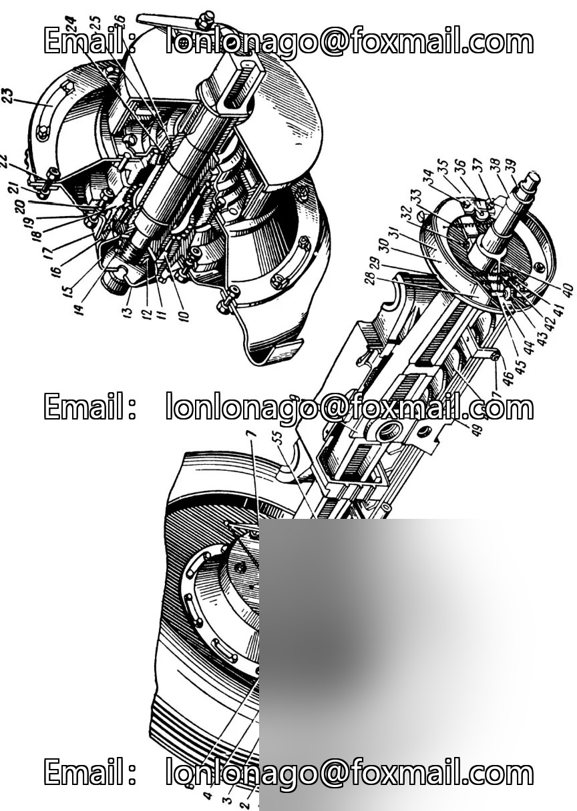
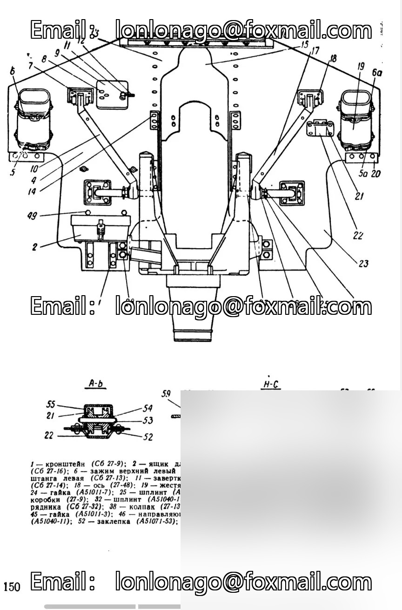
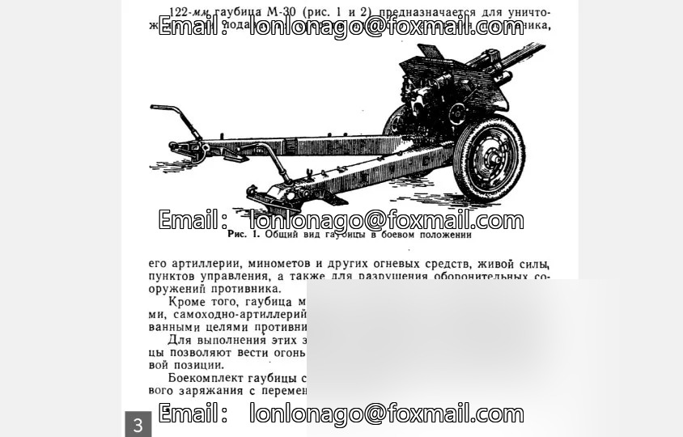

# 122mm M-30 artillery shell reference

## Body

122-mm M-30 howitzer M-1938 (M-30) is a Soviet heavy mortar used in World War II and long-term post-war, designed by Peter Vorobev / the 172 Plant systems, and deployed in 1938.
400-page PDF electronic file
98534
122-mm howitzer M-1938 (M-30) is a Soviet heavy mortar used in World War II and long-term post-war, designed by Peter Vorobev / the 172 Plant systems, and deployed in 1938.
It participated in the Soviet-Soviet War and was extensively equipped with the Warsaw Pact and foreign aid countries after the war, with good reliability and ballistics performance suitable for rapid-firing fire support.
Common projectile weight is about 21.7 kg, maximum range about 11.8 km (based on projectile type / charge / version), can be moved using towed mechanism.

Content usually includes: fire arm construction, part names, operation procedures, aiming and shooting preparation, maintenance, fault handling, towing/positioning operation, ammunition and charges, technical inspection, etc.
In 1970, the fourth edition stated that although it was designed in 1938, it served and was maintained for a long time in the Soviet army.
Electronic data, returned upon sale.

The material reference covers the 122-mm M-30 grenade launcher, including 1938-type data, multiple pages of PDF, and corresponding technical documents.

<!-- AI_ENRICHED -->

## Images

## Payment

Here is a pay link on Stripe ( https://buy.stripe.com/3cs8yP7sY87d0vu9AB ). Please contact me lonlonago@foxmail.com after funding $89, and I will send you a complete data files , thank you!

